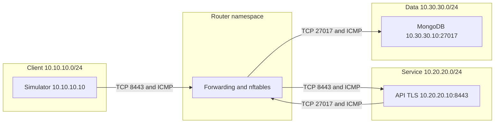

# Topology

The lab container is the Linux host. These namespaces are the only project networks.

| Zone | Namespace | Interface | Address | Gateway |
|---|---|---|---|---|
| Client | `ft-client` | `c-ns` | `10.10.10.10/24` | `10.10.10.1` |
| Router | `ft-router` | `c-rt`, `s-rt`, `d-rt` | `.1` on each segment | forwards |
| Service | `ft-service` | `s-ns` | `10.20.20.10/24` | `10.20.20.1` |
| Data | `ft-data` | `d-ns` | `10.30.30.10/24` | `10.30.30.1` |

Forward policy is drop. The allows are client to API TCP 8443, API to MongoDB TCP 27017, and ICMP between those pairs. Client to `10.30.30.0/24` is an explicit drop. MongoDB binds only `10.30.30.10` and its Unix socket is disabled.

Captures are taken on `c-rt`, `s-rt`, and `d-rt` inside the router namespace. Delay for the impairment trial is applied only to `c-ns` and `c-rt`.

iperf3 uses TCP 5201 and a rule that the measurement script inserts and then deletes. The saved nftables ruleset should not contain port 5201.
